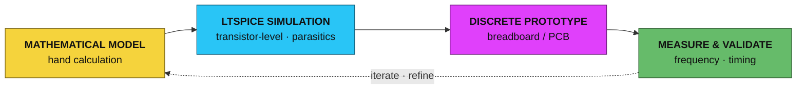

```text
╔══════════════════════════════════════════════════════════════════════════╗
║                                                                          ║
║   YUSUF YILDIZ                                              Rev. 2.1     ║
║   Electrical & Electronics Engineering — Senior Student                  ║
║                                                                          ║
║   FOCUS    Analog Circuit Design · Discrete Electronics ·                ║
║            Signal Integrity                                              ║
║   ORIGIN   Abdullah Gül University (AGU) · Kayseri, Turkey               ║
║            100% English Curriculum                                       ║
║   CONTACT  yusufyldz.eee@gmail.com                                       ║
║                                                                          ║
╚══════════════════════════════════════════════════════════════════════════╝

      ∿∿∿∿∿∿∿∿∿∿∿∿∿∿∿∿∿∿∿∿∿           ┌──┐    ┌──┐    ┌──┐
      analog domain                ────┘  └────┘  └────┘  └────  digital domain
```

<div align="center">

<a href="mailto:yusufyldz.eee@gmail.com"></a>


[**1** General Description](#1-general-description) · [**2** Features](#2-features) · [**3** Applications](#3-applications) · [**4** Design Methodology](#4-design-methodology) · [**5** Projects](#5-project-portfolio) · [**6** Supplementary Docs](#6-supplementary-documentation) · [**7** Capabilities](#7-technical-capabilities) · [**8** Contact](#8-contact)

</div>


## 1. GENERAL DESCRIPTION

I am an **Electrical-Electronics Engineering** student at **Abdullah Gül University (AGU)** with a specialized interest in **Analog Circuit Design**, **Discrete Electronics**, and **Signal Integrity**. My engineering philosophy is built on the principle of bridging the gap between complex mathematical models and robust, industrial-grade hardware.

> [!IMPORTANT]
> **Design philosophy** — Rather than relying solely on high-level integrated solutions, I am passionate about exploring the **"physics of the circuit"**: designing from the ground up using discrete components.

My work involves extensive **transistor-level modeling in LTSpice**, where I analyze parasitic behaviors, timing constraints, and frequency responses. From designing high-precision **Sallen-Key active filters** to optimizing **Wien Bridge oscillators**, I focus on developing electronic systems that are not only functional but also optimized for **reliability and cost-effectiveness** in R&D environments.

## 2. FEATURES

- Ground-up **discrete design** — exploring the *"physics of the circuit"* at BJT/MOSFET level
- Extensive **transistor-level modeling** in LTSpice: parasitic behaviors, timing constraints, frequency response
- High-precision **Sallen-Key active filter** design
- **Wien Bridge oscillator** design and optimization
- Bridging **complex mathematical models** with **robust, industrial-grade hardware**
- Systems optimized for **reliability and cost-effectiveness** in R&D environments

## 3. APPLICATIONS

- Biomedical signal acquisition and real-time analysis
- Microcontroller-free capacitive sensing interfaces
- Semiconductor lithography process simulation (EUV / ArF)
- CMOS digital building blocks — oscillators, counters, multiplexers


## 4. DESIGN METHODOLOGY



Every design starts from first principles: hand analysis, then transistor-level SPICE verification of parasitics and timing, then a discrete hardware prototype — iterated until the bench measurements agree with the model.


## 5. PROJECT PORTFOLIO

*Projects are color-coded like oscilloscope channels —*
   

### 5.1 — SAPA · Electronic Stethoscope

   

Designed a **low-noise electronic stethoscope** using Sallen-Key active filters. Integrated **Arduino ADC** with a **MATLAB GUI** for real-time heart sound analysis.

```text
acoustic input ─▶ [ Sallen-Key active filters ] ─▶ [ Arduino ADC ] ─▶ [ MATLAB GUI · real-time analysis ]
```

**Documentation** — [](./SAPA_Electronic_Stethoscope_Report.pdf)

### 5.2 — Capacitive Touch Sensor Lock

   

Developed a **microcontroller-free** touch interface using a **Wien Bridge Oscillator (50 kHz)** and discrete **BJT amplifiers** for cost-sensitive applications.

```text
touch plate (ΔC) ─▶ [ Wien Bridge oscillator · 50 kHz ] ─▶ [ discrete BJT amplifiers ] ─▶ [ lock output ]
```

**Documentation** — [](./Analog_Capacitive_Touch_Sensor_Report.pdf)

### 5.3 — LithoSuite · Lithography Simulator

   

Built a **physics-based simulation engine in MATLAB** to model **EUV/ArF Lithography** processes, analyzing manufacturing failure cases like **CD & DOF**.

```text
process parameters (EUV/ArF) ─▶ [ physics-based simulation engine · MATLAB ] ─▶ [ CD & DOF failure analysis ]
```

**Documentation** — [](./LithoSuite_Lithography_Simulation_Report.pdf)

### 5.4 — Digital System Design

  

Designed **CMOS Ring Oscillators** and **Switchable Counters**. Verified **timing constraints** and logic levels using **SPICE simulations**.

```text
CMOS schematic (ring osc. · counters) ─▶ [ SPICE simulation ] ─▶ [ timing & logic-level verification ]
```

**Documentation** — [](./Digital_System_Design_Final_Report.pdf)

<!-- ═════════════════════ YENİ PROJELER BURAYA ═════════════════════
Yeni 2 projeyi 5.5 ve 5.6 olarak bu yorumun ÜSTÜNE ekleyin.
Şablon (kopyala, doldur — kanal rengi olarak CH5/CH6 için yeni bir
hex seçebilir ya da paleti tekrarlayabilirsiniz):

### 5.5 — Proje Adı

 

Kısa proje açıklaması (1–2 cümle, İngilizce).

```text
giriş ─▶ [ blok 1 ] ─▶ [ blok 2 ] ─▶ çıkış
```

**Documentation** — [](./Rapor_Dosyasi.pdf)

═════════════════════════════════════════════════════════════════ -->


## 6. SUPPLEMENTARY DOCUMENTATION

Detailed breakdowns of specific digital design tasks:

| Document | Link |
|:---|:---:|
| **CMOS Ring Oscillator Design Report** | [](./CMOS_Ring_Oscillator_Design_Report.pdf) |
| **CMOS Multiplexer Design Report** | [](./CMOS_Multiplexer_Design_Report.pdf) |

## 7. TECHNICAL CAPABILITIES

| Category | Capabilities |
|:---|:---|
| **Hardware Design** |     |
| **Embedded Systems** |    |
| **Simulation & Tools** |     |
| **Programming** |    |

## 8. CONTACT

| Parameter | Value |
|:---|:---|
| Designation | Yusuf Yıldız |
| Function | Electrical & Electronics Engineering — Senior Student |
| Institution | Abdullah Gül University (AGU) · 100% English Curriculum |
| Location | Kayseri, Turkey |
| Interface | [yusufyldz.eee@gmail.com](mailto:yusufyldz.eee@gmail.com) |

Feel free to explore the reports linked above.

<div align="center">

<a href="mailto:yusufyldz.eee@gmail.com"></a>

</div>


<div align="center">

**REVISION HISTORY**

| Rev. | Date | Description |
|:---:|:---:|:---|
| 1.0 | — | Initial release — first four project reports published |
| 2.0 | 2026-07 | Portfolio restructured in datasheet format |
| 2.1 | 2026-07 | Color revision — oscilloscope channel palette, Mermaid methodology diagram |

<sub>Designed at the transistor level · documented like a datasheet · color-coded like a scope.</sub>


</div>
